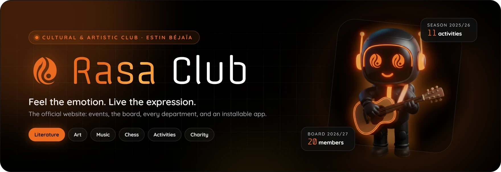
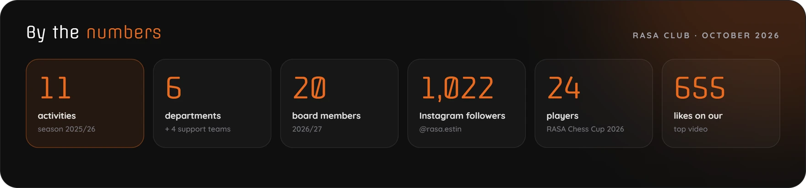
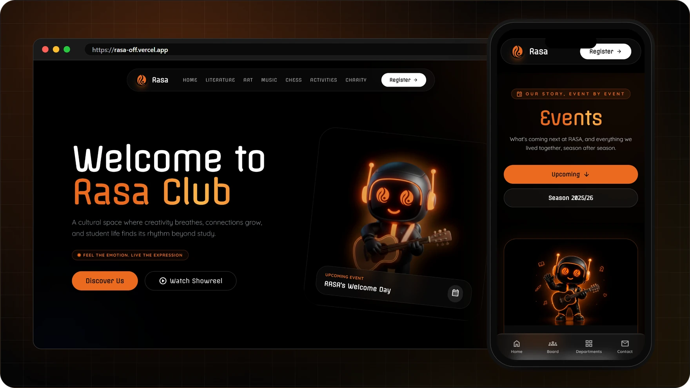
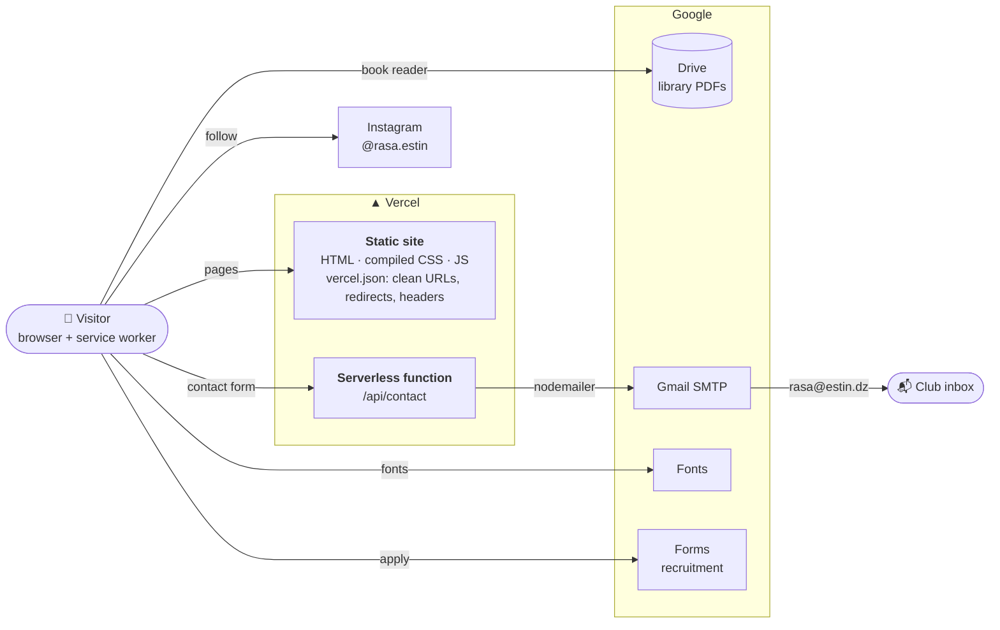

<div align="center">

<a href="https://rasa-off.vercel.app">
  
</a>

<br>

[](https://rasa-off.vercel.app)
[](https://vercel.com)
[](#-performance--offline)
[](https://www.instagram.com/rasa.estin/)

**Events · the board · six departments · libraries with an in-page reader · charity · recruitment**<br>
the home of Rasa Club at ESTIN Béjaïa, fast on any phone, and installable as an app.

[**Visit the site**](https://rasa-off.vercel.app) &nbsp;·&nbsp;
[Features](#-features) &nbsp;·&nbsp;
[Architecture](#-architecture) &nbsp;·&nbsp;
[Visual identity](#-visual-identity) &nbsp;·&nbsp;
[SEO](#-seo--ai-discoverability) &nbsp;·&nbsp;
[Develop](#-development)

</div>

<br>



<br>

## ✦ Overview

**Rasa** is the cultural and artistic student club of **ESTIN** (École Supérieure en Sciences et Technologies
de l'Informatique et du Numérique) in Amizour, Béjaïa, Algeria. It was created by students to ease the pressure
of studies with a space for literature, art, music, chess, games, charity and cultural exchange. The club room
is on the ground floor of the ESTIN library.

This repository is the club's website. It is a **hand-built static site**: plain HTML, Tailwind CSS compiled per
page, and vanilla JavaScript, with no framework. It is served by **Vercel** with clean URLs, books stream from
**Google Drive**, and one **serverless function** sends the contact form to the club's inbox. A service worker
makes it installable and keeps it working offline.

<div align="center">
  
</div>

<br>

## ✦ Features

<table>
<tr>
<td width="50%" valign="top">

### 🏠 Home
Hero with ROSO the mascot, the club story, a photo carousel, the next event and season
highlights, the **2026/27 board** (with the 2025/26 past board), a contact form and an FAQ.<br>
<sub>`/`</sub>

### 🗓️ Events
The upcoming event and every activity of each season as numbered cards with dates, places,
partners and photos, all generated from one data file.<br>
<sub>`/events` · `data/events.js`</sub>

### 📚 Literature & libraries
Reading, book fairs and the Speaking Club, plus English, French and Arabic libraries.
Books open in a **polished in-page reader** (Google Drive viewer, download, full screen).<br>
<sub>`/literature` · `/english` · `/french` · `/arabic`</sub>

### ♟️ Chess
Training, puzzles and the **RASA Chess Cup 2026** recap: key figures, podium,
timeline and an 18-photo gallery with a lightbox.<br>
<sub>`/chess`</sub>

</td>
<td width="50%" valign="top">

### 🎨 Art · 🎵 Music · 🎮 Activities
Department pages with their managers, mission and members' work
(art gallery, instruments, games and tournaments).<br>
<sub>`/art` · `/music` · `/activities`</sub>

### 🤲 Charity
Solidarity campaigns with accredited associations, starting with children with cancer,
and the ways students can help. Rasa never collects money online.<br>
<sub>`/charity`</sub>

### 🙋 Recruitment
Open core-team positions for 2026/27 with a one-tap application form.
The **Register** button switches to `/noregistrations` when nothing is open.<br>
<sub>`/recruitment` · `/noregistrations`</sub>

### 📱 App experience
Installable PWA with shortcuts, offline pages, a phone bottom bar with a sliding highlight,
a departments sheet and a scroll-progress line.<br>
<sub>`manifest.webmanifest` · `sw.js` · `js/mobile-nav.js`</sub>

</td>
</tr>
</table>

> [!NOTE]
> The six departments are **Literature, Art, Music, Chess, Activities and Charity**, supported by the
> **Multimedia, Communication, Logistics and Human Resources** teams. Each department page reads its managers
> from the same board as the homepage.

<br>

## ✦ Architecture



| Layer | What it does |
|---|---|
| **Static pages** | Every page is a real `.html` file. Vercel serves `page.html` as the clean URL `/page` (`cleanUrls`). |
| **Styles** | Tailwind CSS 3.4 compiled per page into `css/<page>.css` (28–46 KB), from `tailwind/<page>.config.cjs`. |
| **Shared behaviour** | `js/mobile-nav.js` (phone bar, departments sheet), `js/events.js` (event cards), `js/book-reader.js` (reader), `js/pwa.js` (service worker + install prompt). |
| **Content data** | Events in `data/events.js`; the board in `index.html`; the FAQ in `scripts/build.mjs`. One source each, reused everywhere. |
| **Build** | `scripts/build.mjs` writes SEO tags, JSON-LD, pre-rendered events, the FAQ, `sitemap.xml` and `llms.txt` into the pages. No dependencies. |
| **Contact** | `api/contact.js` validates the form server-side and sends it with nodemailer to **rasa@estin.dz**. |

> [!IMPORTANT]
> Some blocks inside the pages are **generated**: `<!-- seo:start -->`, `<!-- prerender:start -->` and
> `<!-- faq:start -->`, plus everything in `css/`. Edit the sources (`data/events.js`, the board cards,
> `scripts/build.mjs`, Tailwind classes) and re-run the build, or your edits will be overwritten.

<br>

## ✦ Project structure

```text
.
├── index.html, events.html, …          13 pages (one file per route) + offline.html
├── css/<page>.css                      compiled Tailwind, generated by scripts/build-css.mjs
├── tailwind/<page>.config.cjs          Tailwind settings per page · input.css
│
├── js/
│   ├── mobile-nav.js                   phone bottom bar, departments sheet, scroll progress
│   ├── events.js                       event cards (browser + build-time pre-render)
│   ├── book-reader.js                  library reader overlay
│   └── pwa.js                          service-worker registration, install prompt
├── data/events.js                      upcoming events + seasons
├── api/contact.js                      contact form → email (Vercel function)
│
├── images/                             board-2026-27/ · events/ · chess-cup-2026/ · og/ · …
├── icons/                              app and home-screen icons
├── manifest.webmanifest  sw.js         installable app and offline cache
├── robots.txt  sitemap.xml  llms.txt   search engines and AI assistants
├── vercel.json                         clean URLs, redirects, headers
│
├── scripts/                            build, image and README tooling (not deployed)
├── docs/brand/                         brand swatches used in this README
└── .github/assets/                     README images · src/ holds their HTML sources
```

<br>

## ✦ Visual identity

Rasa's look is **dark, warm and expressive**: deep black canvases, a single glowing orange accent,
soft glass surfaces and generous rounded shapes.

<table>
<tr>
<td align="center" width="50%">
  <br>
  <sub><b>The flame</b> · <code>rasa-logo.png</code>, transparent. App icons in <code>icons/</code> place it on black.</sub>
</td>
<td align="center" width="50%">
  <br>
  <sub><b>ROSO</b>, the club mascot · a friendly robot with the flame in its eyes and a guitar in its hands.</sub>
</td>
</tr>
</table>

| Swatch | Token | Hex | Use |
|:---:|---|---|---|
|  | `primary` | `#EA6A1F` | The Rasa orange: buttons, links, highlights, glows |
|  | `primary-dark` | `#C5520E` | Pressed states, deep accents |
|  | gold | `#F9A825` | Metallic gradient, secondary accent |
|  | gold light | `#FFB74D` | Shine in the metallic headline |
|  | `background-dark` | `#000000` | Page background |
|  | `surface` | `#0F0F0F` | Cards and panels |
|  | — | `#141418` | Raised surfaces (sheets, emails) |
|  | `gray-400` | `#A1A1AA` | Body copy on black |

<br>
<sub>Signature gradient for hero words (`.text-metallic`, with an animated shine).</sub>

| Element | Choice |
|---|---|
| **Type** | **Offside** for display and buttons (fallback Space Grotesk) · **Quicksand** for text · **Tajawal** for Arabic · **Cinzel** accents on Activities · **Material Symbols** icons |
| **Glass** | Panels `rgba(255,255,255,.03)` + `blur(16px)` + `1px` border `rgba(255,255,255,.08)`; cards `rgba(20,20,20,.6)` with an orange border and glow on hover |
| **Shape** | Radii `0.5rem` → `3rem`, pills `9999px`; tight bold headings; small uppercase labels with wide tracking |
| **Motion** | Short fades and slides (300 ms), the floating mascot, shine on metallic text; reduced motion respected in overlays |
| **Voice** | Warm, energetic and inclusive, in English with French and Arabic where they belong. Honest numbers only. |

> [!TIP]
> **Logo rules:** keep the flame orange on black or dark surfaces, leave clear space of at least a quarter of its
> width around it, and never stretch or recolour it. The only effect used is a soft orange glow.

<br>

## ✦ SEO & AI discoverability

<details open>
<summary><b>What is in place</b></summary>
<br>

| Area | How it works |
|---|---|
| **Metadata** | Every page has its own title and description, a canonical URL, robots rules, Open Graph and Twitter cards with branded 1200×630 images (`images/og/`). |
| **Structured data** | JSON-LD on every page: `WebPage`, `BreadcrumbList`, and on the homepage `Organization` (the board as `OrganizationRole` members), `WebSite` and `FAQPage`; `/events` lists dated `Event`s in an `ItemList`. |
| **Pre-rendered content** | Events are written into the HTML at build time, so crawlers that don't run JavaScript still read them. |
| **Visible FAQ** | Nine questions on the homepage, generated from the same source as the `FAQPage` schema. |
| **Sitemap** | `sitemap.xml` lists the 12 indexable pages; `/noregistrations` and `/offline` are `noindex`. |
| **robots.txt** | Everything is crawlable except `/api/` and `/offline`; AI assistants (GPTBot, OAI-SearchBot, PerplexityBot, ClaudeBot, Google-Extended) are welcome. |
| **llms.txt** | [`llms.txt`](https://rasa-off.vercel.app/llms.txt) describes the club, the pages, the board, the events and the FAQ for AI assistants ([llmstxt.org](https://llmstxt.org)). |
| **Clean URLs** | `/events`, not `/events.html`. Old addresses answer `308` redirects so shared links keep working. |
| **Images** | Descriptive `alt` text everywhere; photos compressed to WebP. |

</details>

> [!WARNING]
> **Renaming a page?** Add a permanent redirect from the old path in `vercel.json` (both `/old` and `/old.html`),
> update the page list in `scripts/build.mjs`, `sw.js` and `js/mobile-nav.js` if it's a department, then run the build.

<br>

## ✦ Performance & offline

| Asset | How it's cached |
|---|---|
| HTML pages | Always revalidated by the browser, so new content shows at once; the service worker fetches them network-first |
| CSS, JS, data | Precached by the service worker and refreshed in the background (stale-while-revalidate) |
| Images | Cached by the service worker on first view (cache-first, up to 150) |
| App icons | 7 days (`vercel.json`) |
| `sw.js`, manifest | Never cached, so updates reach every visitor |

The **service worker** (`sw.js`) precaches every page, stylesheet and script, so the site opens instantly on repeat
visits and keeps working without a connection; pages it hasn't seen fall back to a branded `/offline` page.
`/api/` and form submissions are never touched.

> [!TIP]
> When you ship a change, bump **`VERSION`** in `sw.js`. Installed apps then drop their old caches and fetch
> the new files on the next visit.

<br>

## ✦ Development

**Install** once (Tailwind CLI for the CSS build, nodemailer for the contact function):

```bash
npm install
pip install pillow pillow-heif    # only for the image scripts
```

**Run locally**: the preview server behaves like Vercel (clean URLs and redirects):

```bash
python scripts/serve.py
# → http://127.0.0.1:5510
```

**Build** after editing:

```bash
node scripts/build-css.mjs        # after changing Tailwind classes in a page, js/ or data/
node scripts/build.mjs            # after editing events, the board, the FAQ or a page title/description
```

**Deploy**: push to **`main`**. Vercel publishes it automatically. The contact function needs two environment
variables in Vercel → Settings → Environment Variables: `EMAIL_USER` (the Gmail address) and `EMAIL_PASS`
(a Gmail App Password).

<details>
<summary><b>Content workflows</b></summary>
<br>

| Task | How |
|---|---|
| **Add or edit an event** | Edit `data/events.js` (instructions at the top), then `node scripts/build.mjs`. When an upcoming event is over, move it into its season. |
| **Event photos** | `python scripts/optimize-gallery.py "<source folder>" images/events/<season>/<id>`, then set `cover` in `data/events.js`. |
| **Change the board** | Edit the cards in `index.html` (`#membersScroll`), then `node scripts/build.mjs`. |
| **Board photos** | `python scripts/optimize-board.py "<source folder>" images/board-2026-27` (600×600 WebP, face-safe crop). |
| **FAQ** | Edit `FAQ` in `scripts/build.mjs`, then run it. |
| **Heavy images** | `python scripts/compress-in-place.py 300 1600 <files>` (same names, smaller files). |
| **Share images / app icons** | `python scripts/make-og.py` · `python scripts/make-icons.py` |

> Edited an original photo? The site never reads the source folders, so re-run the matching script.

</details>

<details>
<summary><b>Checklist for a new page</b></summary>
<br>

1. Copy a sibling page so the `<head>` (fonts, manifest, PWA tags) and the navigation stay identical.
2. Give it its own `<title>` and `<meta name="description">`.
3. Create `tailwind/<page>.config.cjs` (copy a sibling) and run `node scripts/build-css.mjs`; link `/css/<page>.css`.
4. Add it to `PAGES` in `scripts/build.mjs` (route, share image, breadcrumb) and run the build.
5. Add it to the precache list in `sw.js` and bump `VERSION`.
6. Link to it with a real `<a href="/page">`. If it's a department, add it to `DEPARTMENTS` in `js/mobile-nav.js`.

</details>

<details>
<summary><b>Maintaining this README</b></summary>
<br>

The banner, the numbers card and the preview are HTML files in `.github/assets/src/`, rendered with the site's real
fonts and colours:

1. Edit `banner.html` or `stats.html` (refresh the numbers each season).
2. Start the preview server (`python scripts/serve.py`).
3. Run `python scripts/render-readme-assets.py`: it screenshots the site with headless Chrome/Edge
   (`shots/desktop.png` at 1440×900 and `shots/mobile.png` at 390×844, both 2×), renders the three cards
   at 2× with a transparent background, and saves `banner.webp`, `stats.webp` and `preview.webp` 1760 px wide.

</details>

<br>

## ✦ Roadmap

- [ ] Submit `sitemap.xml` in Google Search Console and Bing Webmaster Tools
- [ ] Add privacy-friendly analytics (e.g. Vercel Web Analytics) to see which pages and events students visit
- [ ] Contact details for the four board members who don't have them yet
- [ ] A dedicated share image for each department page
- [ ] French and Arabic versions of the main pages, with `hreflang`
- [ ] A custom domain for the club
- [ ] Run the CSS and SEO builds automatically on Vercel instead of committing their output

<br>

## ✦ Contact

<table>
<tr>
<td>

**Rasa Club** · ESTIN, Amizour, Béjaïa

✉️ [rasa@estin.dz](mailto:rasa@estin.dz) &nbsp;·&nbsp;
📸 [Instagram @rasa.estin](https://www.instagram.com/rasa.estin/) &nbsp;·&nbsp;
💼 [LinkedIn](https://www.linkedin.com/company/rasa-club/) &nbsp;·&nbsp;
🌐 [rasa-off.vercel.app](https://rasa-off.vercel.app)

**Website** designed and built by the Rasa Design Department ·
developer [**Redouane Mohamed Islem**](https://www.linkedin.com/in/redouane-mohamed-islem-48923a435)
(Human Resources Manager & Website Developer, board 2026/27)

</td>
</tr>
</table>

<div align="center">
<br>

<br>
<sub><b>Rasa Club</b> · © 2026 · ESTIN Béjaïa · Books in the libraries remain the property of their authors.</sub>
<br>
<sub>Feel the emotion. Live the expression.</sub>
</div>
