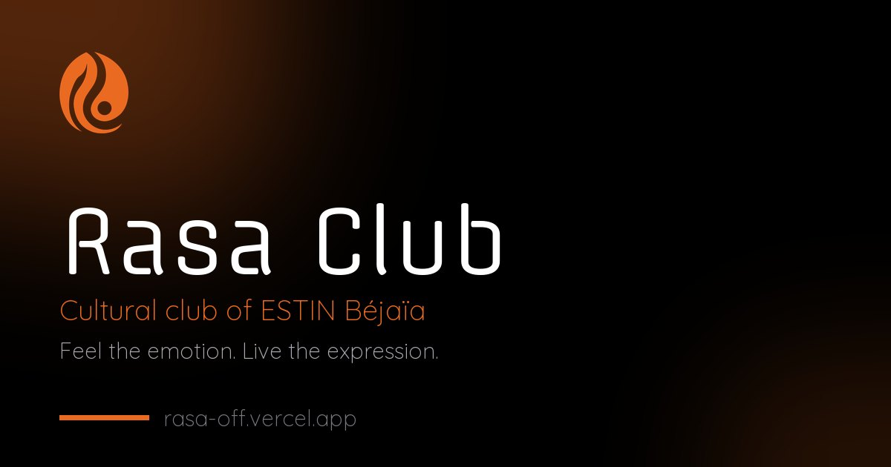

<div align="center">


# Rasa Club — ESTIN Béjaïa

**The official website of Rasa, the cultural and artistic club of ESTIN.**
*Feel the emotion. Live the expression.*

[](https://rasa-off.vercel.app)
[](#progressive-web-app)
[](https://www.instagram.com/rasa.estin/)



</div>

---

## Contents

1. [About the club](#about-the-club)
2. [Visual identity](#visual-identity)
3. [Tech stack](#tech-stack)
4. [Pages & routes](#pages--routes)
5. [Project structure](#project-structure)
6. [Getting started](#getting-started)
7. [Content workflows](#content-workflows)
8. [Progressive Web App](#progressive-web-app)
9. [SEO & AEO](#seo--aeo)
10. [Performance & accessibility](#performance--accessibility)
11. [Deployment](#deployment)
12. [Conventions](#conventions)
13. [Credits](#credits)

---

## About the club

**Rasa** is the cultural and artistic student club of **ESTIN** (École Supérieure en Sciences et Technologies de l'Informatique et du Numérique) in Amizour, Béjaïa, Algeria. It was created by students to ease the pressure of studies with a space for literature, art, music, chess, games, charity and cultural exchange. The club room is on the ground floor of the ESTIN library.

| | |
|---|---|
| **Departments** | Literature · Art · Music · Chess · Activities · Charity — supported by Multimedia, Communication, Logistics and Human Resources |
| **Season 2025/26** | 11 activities, from Welcome Day and the Algiers book fair (SILA) to Yennayer, the RASA Chess Cup (24 players) and a trip to Tikjda |
| **Contact** | [rasa@estin.dz](mailto:rasa@estin.dz) · [Instagram @rasa.estin](https://www.instagram.com/rasa.estin/) · [LinkedIn](https://www.linkedin.com/company/rasa-club/) |

---

## Visual identity

Rasa's look is **dark, warm and expressive**: deep black canvases, a single glowing orange accent, soft glass surfaces and generous rounded shapes. Every page follows the same system.

### Logo & mascot

<table>
  <tr>
    <td align="center" width="50%">
      <br/>
      <sub><b>The flame</b> — <code>rasa-logo.png</code> (transparent).<br/>App icons in <code>icons/</code> place it on black.</sub>
    </td>
    <td align="center" width="50%">
      <br/>
      <sub><b>ROSO</b>, the club mascot — a friendly robot with the flame in its eyes and a guitar in its hands.</sub>
    </td>
  </tr>
</table>

**Logo rules:** keep the flame orange on black or dark surfaces; leave space around it equal to at least a quarter of its width; never stretch, recolour or add effects other than the soft orange glow used on the site.

### Colour palette

| Swatch | Token | Hex | Use |
|:---:|---|---|---|
|  | `primary` | `#EA6A1F` | The Rasa orange: buttons, links, highlights, glows |
|  | `primary-dark` | `#C5520E` | Pressed states, deep accents |
|  | `gold` | `#F9A825` | Metallic gradient, secondary accent (e.g. External Relations) |
|  | `gold-light` | `#FFB74D` | Shine in the metallic headline gradient |
|  | `background-dark` | `#000000` | Page background |
|  | `surface` | `#0F0F0F` | Cards and panels |
|  | — | `#141418` | Raised surfaces (emails, sheets) |
|  | `gray-400` | `#A1A1AA` | Body copy on black |

**Signature gradient** — used for hero words (`.text-metallic`, animated shine):


```css
background: linear-gradient(to right, #ea6a1f 20%, #ffb74d 40%, #ea6a1f 60%, #ffb74d 80%);
```

### Typography

| Role | Typeface | Where |
|---|---|---|
| Display / headings | **Offside** (fallback Space Grotesk) | Titles, buttons, navigation, numbers |
| Body | **Quicksand** | Paragraphs, labels, UI text |
| Arabic | **Tajawal** | Arabic library page |
| Accent | **Cinzel** | Activities page decorative titles |
| Icons | **Material Symbols Outlined** | All interface icons (filled variant for the active tab) |

All fonts are served by Google Fonts. Headings are bold and tight (`tracking-tight`); small labels are uppercase with wide letter-spacing (`tracking-[0.2em]`–`[0.35em]`).

### UI language

| Element | Recipe |
|---|---|
| **Glass panel** | `rgba(255,255,255,0.03)` fill · `backdrop-filter: blur(16px)` · `1px` border `rgba(255,255,255,0.08)` |
| **Glass card** | `rgba(20,20,20,0.6)` · `blur(8px)` · orange border + glow on hover |
| **Glow** | `box-shadow: 0 0 20–30px rgba(234,106,31,0.4–0.6)` on primary actions |
| **Radii** | `0.5rem` base · `1rem` · `1.5rem` · `2rem` · `3rem` · pills `9999px` |
| **Buttons** | Primary: orange pill, black text. Secondary: transparent pill, `white/20` border |
| **Motion** | Short fades/slides (300 ms), floating hero mascot, shine on metallic text; reduced-motion respected in the reader |

### Voice

Warm, energetic and inclusive — written for students, in English (with French and Arabic content where it belongs). Short sentences, no jargon, and honest numbers only.

---

## Tech stack

| Layer | Choice |
|---|---|
| Markup | Hand-written static HTML pages |
| Styling | **Tailwind CSS 3.4** compiled per page (`css/<page>.css`) + small page-level CSS |
| Behaviour | Vanilla JavaScript, no framework (`js/`) |
| Content data | `data/events.js` (events), board cards in `index.html`, FAQ in `scripts/build.mjs` |
| App shell | Web App Manifest + Service Worker (offline, installable) |
| Backend | One Vercel serverless function, `api/contact.js` (nodemailer → rasa@estin.dz) |
| Hosting | **Vercel** — static files, clean URLs, redirects and headers in `vercel.json` |
| Tooling | Node 18+ build scripts, Python 3 + Pillow for image pipelines |

---

## Pages & routes

| Route | Page |
|---|---|
| `/` | Home — hero, about, memories, events, board 2026/27 (+ past board), contact, FAQ |
| `/events` | Upcoming event and every season's activities |
| `/literature` | Literature department · `/english` · `/french` · `/arabic` libraries with an in-page **book reader** |
| `/art` · `/music` · `/chess` · `/activities` · `/charity` | Department pages |
| `/recruitment` | Core-team recruitment (Register button) |
| `/noregistrations` | Shown when no registration is open (`noindex`) |
| `/offline` | Offline fallback served by the service worker |

Old URLs keep working: `*.html` → clean URL, `/gaming` → `/activities`, `/frensh` → `/french`, `/chess-tournament-regisrations` → `/chess` (permanent redirects).

---

## Project structure

```text
.
├── index.html, events.html, …        pages (one file per route)
├── css/<page>.css                     compiled Tailwind (generated — do not edit)
├── tailwind/<page>.config.cjs         Tailwind settings per page + input.css
├── js/
│   ├── mobile-nav.js                  phone bottom bar, departments sheet, scroll progress
│   ├── events.js                      event cards (browser + build-time pre-render)
│   ├── book-reader.js                 library reader overlay
│   └── pwa.js                         service-worker registration + install prompt
├── data/events.js                     events: upcoming + seasons (single source of truth)
├── api/contact.js                     contact form → email (Vercel function)
├── images/                            photos (board, events, chess cup, og cards, …)
├── icons/                             app & home-screen icons
├── docs/brand/                        README brand swatches
├── scripts/                           build & image tooling (not deployed)
├── sw.js · manifest.webmanifest · offline.html
├── robots.txt · sitemap.xml · llms.txt     generated / SEO files
└── vercel.json                        clean URLs, redirects, headers
```

---

## Getting started

**Requirements:** Node 18+, Python 3.10+ (for image scripts).

```bash
npm install                      # Tailwind CLI + plugins (dev), nodemailer (contact function)
pip install pillow pillow-heif   # only needed for the image scripts
python scripts/serve.py          # http://127.0.0.1:5510 — behaves like Vercel (clean URLs, redirects)
```

After editing content or styles, rebuild what changed:

```bash
node scripts/build-css.mjs       # after changing Tailwind classes (pages, js/, data/)
node scripts/build.mjs           # after editing events, the board, the FAQ or a title/description
```

---

## Content workflows

| Task | How |
|---|---|
| **Add or edit an event** | Edit `data/events.js` (instructions at the top), then `node scripts/build.mjs`. Upcoming events go in `upcoming`; when over, move them into their season. |
| **Event photos** | Put originals in `../Events/<season>/<NN event>/`, then `python scripts/optimize-gallery.py "<folder>" images/events/<season>/<id>` and set `cover` in `data/events.js`. |
| **Change the board** | Edit the cards in `index.html` (`#membersScroll`), then `node scripts/build.mjs` (updates structured data and `llms.txt`). |
| **Board photos** | `python scripts/optimize-board.py "../2026-2027 Board" images/board-2026-27` (600×600 WebP, face-safe crop). |
| **FAQ** | Edit `FAQ` in `scripts/build.mjs`, then run it (updates the visible section **and** the FAQPage schema). |
| **Phone menu departments** | Edit `DEPARTMENTS` in `js/mobile-nav.js`. |
| **Heavy images** | `python scripts/compress-in-place.py 300 1600 <files>` (same names, smaller files). |
| **Share images** | `python scripts/make-og.py` → `images/og/*.jpg` (1200×630). |
| **App icons** | `python scripts/make-icons.py` → `icons/`. |

> Edited an original photo? The site never reads the source folders — re-run the matching script so `images/` is updated.

---

## Progressive Web App

- **Installable** on Android, iOS (Add to Home Screen) and desktop; standalone, black theme, shortcuts to Events, Board, Charity and Join.
- **Offline**: every page, stylesheet and script is precached; visited images are cached (150 max); unknown pages fall back to `/offline`.
- **Strategy** (`sw.js`): pages network-first · images cache-first · CSS/JS/data and Google Fonts stale-while-revalidate · `/api` untouched.
- **Shipping an update:** bump `VERSION` in `sw.js` so installed apps drop old caches.

---

## SEO & AEO

`node scripts/build.mjs` keeps search and answer engines in sync with the content:

- **Per page:** canonical URL, robots, Open Graph and Twitter cards with branded 1200×630 images.
- **Structured data (JSON-LD):** `Organization` (with the board as `OrganizationRole` members), `WebSite`, `WebPage`, `BreadcrumbList`, `FAQPage`, and an `ItemList` of dated `Event`s.
- **Pre-rendered HTML:** events are written into the pages so crawlers that don't run JavaScript still read them.
- **Files:** `sitemap.xml`, `robots.txt` (AI crawlers welcome), and [`llms.txt`](https://rasa-off.vercel.app/llms.txt) — a plain summary for AI assistants.
- **Visible FAQ** on the homepage, generated from the same source as the schema.

---

## Performance & accessibility

- Compiled CSS per page (28–46 KB) instead of the 400 KB Tailwind CDN script.
- Images compressed (WebP for new content, ≤ 1600 px); lazy-loaded below the fold.
- Clean semantic headings (one `h1` per page), descriptive `alt` text, labelled icon buttons, visible focus, keyboard support (Esc, arrows, focus trap in overlays), reduced-motion support in the reader.
- Mobile-first layouts: full-width bottom bar with safe-area padding, centred carousels with prev/next buttons.

---

## Deployment

Pushing to **`main`** deploys automatically on **Vercel**.

| Setting | Where |
|---|---|
| Clean URLs, redirects, headers | `vercel.json` |
| Contact function secrets | Vercel → Project → Settings → Environment Variables: `EMAIL_USER` (Gmail address), `EMAIL_PASS` (Gmail App Password) |
| Not deployed | `scripts/`, `tailwind/`, `docs/`, Markdown, raw/private files (`.vercelignore`) |

---

## Conventions

- **Never commit private or raw files** (applicant exports, `.CR2`, `.psd`, `.heic`) — `.gitignore` blocks them.
- HTML files use **CRLF** line endings — avoid tools that rewrite whole files (e.g. `sed -i`).
- Generated blocks (`<!-- seo:start -->`, `<!-- prerender:start -->`, `<!-- faq:start -->`) and `css/` are rebuilt by scripts — edit the sources instead.
- Commit messages: short imperative subject, explanatory body.

---

## Credits

Designed and built by the **Rasa Design Department**.

**Website developer:** [Redouane Mohamed Islem](https://www.linkedin.com/in/redouane-mohamed-islem-48923a435) — Human Resources Manager & Website Developer, board 2026/27.

<div align="center">
<sub>© Rasa Club · ESTIN Béjaïa · <a href="https://rasa-off.vercel.app">rasa-off.vercel.app</a></sub>
</div>
